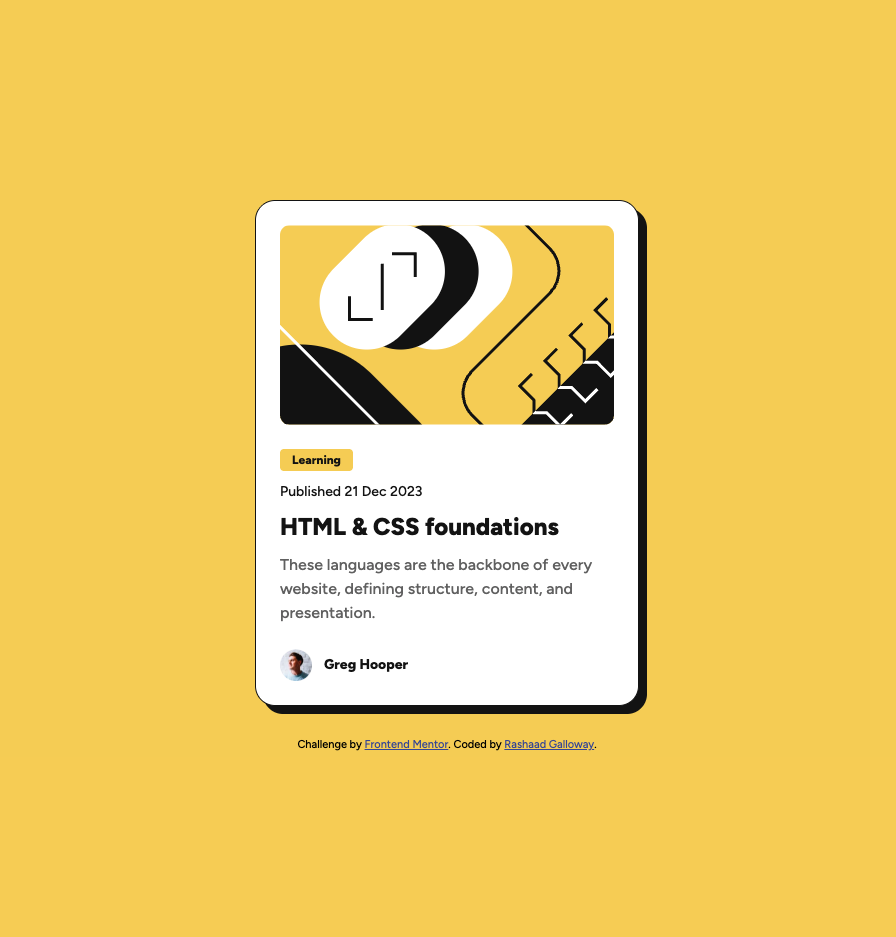

# Frontend Mentor - Blog preview card solution

This is a solution to the [Blog preview card challenge on Frontend Mentor](https://www.frontendmentor.io/challenges/blog-preview-card-ckPaj01IcS). Built as a lab for the Per Scholas full-stack program.

## Table of contents

- [Overview](#overview)
  - [The challenge](#the-challenge)
  - [Screenshot](#screenshot)
  - [Links](#links)
- [My process](#my-process)
  - [Built with](#built-with)
  - [What I learned](#what-i-learned)
- [Author](#author)

## Overview

### The challenge

- Refactor the website using Tailwind or Bootstrap. I chose Tailwind.

### Screenshot

### Links

- Solution URL: [GitHub repo](https://github.com/mrg-repo/Blog-Preview-Card-Tailwind)
- Live Site URL: [GitHub Pages](https://mrg-repo.github.io/Blog-Preview-Card-Tailwind/)

## My process
- My approach while completing this lab was to attempt to take the CSS page line by line and convert it into Tailwind by integrating classes directly into the index.html file.

### Built with

- Tailwind
- Flexbox
- Semantic HTML5 markup (main, article, h1, p, footer)
- Google Fonts (Outfit)

### What I learned
- When using Tailwind, utility classes replace the style.css via direct insertion into the index.html file. 
- You can use `text` to change both the font size and color
- Ultimately, Tailwind generates CSS behind the scenes for us

## Author

- GitHub - [MRG-REPO](https://github.com/mrg-repo)
